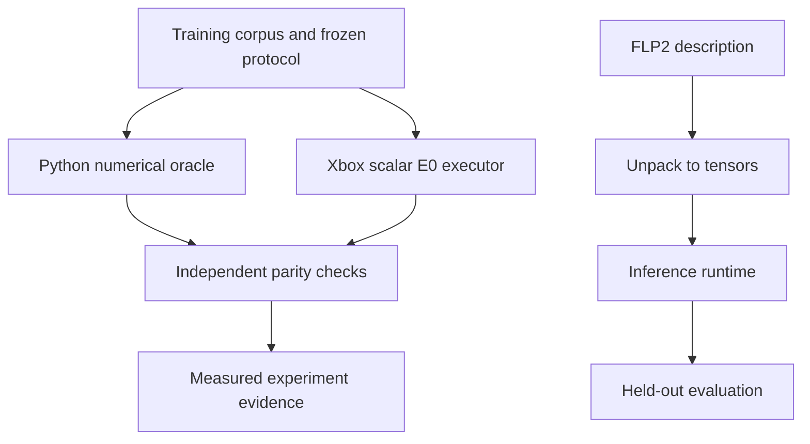

# Architecture

Owner of how the host is divided. The thesis is [concept](concept.md). The 1/16
protocol is [ADR 0023](adr/0023-e1-1-16-pilot.md). Module lines are the
[code map](operations/code-map.md). What is running is [STATUS](STATUS.md).

An October 2026 sketch of this page sat on the unmerged branch
`docs/excellence-research-20261001`. This page replaces that sketch. That
branch's excellence plan, paper outline, and research notes 08–12 stay
unmerged history.

## Stored model

One `TinyGPT`. Pre-norm RMSNorm, RoPE, causal attention, and a tied embedding.
`GPTConfig` carries the scalar fields only. A vector core does not add a field.

A scalar core uses `core_fmt` `ternary` or `2bit`. Scientific E0 cores are those
two. The embedding is the scalar 4-bit record. Norms are raw fp16.

A vector core sets `core_fmt` to `vq` and takes one `VectorBook`. Every core
matrix shares that book. The embedding stays the scalar 4-bit record. Core
scales stay `row8log`. `delta` stays in the header and the vector core does not
read it. Blocks run once: there is no iteration loop. Recursion is E1a and is
not in this host. A computed trellis is E1b and is not in this host.

## File

[ADR 0006](adr/0006-flp2-only.md) makes FLP2 the only blob. A scalar artifact has
an empty shared section. A vector artifact stores one `VQB1` book in that
section, once, not once per matrix. `VQF1` remains the CPU qualification fixture
from [ADR 0013](adr/0013-e1-functional-qualification.md). The byte order is
decision 14 of [ADR 0023](adr/0023-e1-1-16-pilot.md).

A learned book stores its fp16 entries. A fixed book stores the seed and the
generator identity. Scales, the seed, and the decoder are part of the
description. A seed book still pays for its scales, its seed, and the decoder.

## Training

Scalar WSD is unchanged. `TrainSpec` has no vector fields, so a scalar
checkpoint spec stays the same. The values are ADR 0023 decisions 7–9. The host
keeps them as constants in `train.py`: assignment on the cadence, a held index
and scale record, and a cooldown file that is the quantized FLP2 container. A
learned book reseeds an unused entry from the same PCG32 stream. A fixed book
logs the dead entry and keeps the seed, because the file stores the seed and a
rewritten entry would not round-trip.

## Two machines

The research path compares models. The Python oracle in this repository is the
numerical reference, including the vector core. The Xbox package trains scalar
E0. It is not a vector executor. [ADR 0023](adr/0023-e1-1-16-pilot.md) keeps the
1/16 pilot on CPU until a vector executor matches this oracle on identical
inputs and identical artifact bytes.

The artifact path is the mounted data floppy. The static C runtime, tokenizer
image, and FAT12 layout are E3 and E4. They are not in this repository.

## Responsibility map

| Layer | Source | Boundary |
| --- | --- | --- |
| Model | `src/floppylm/model.py`, `codec.py` | Scalar and vector TinyGPT. The book is an argument, not a config field. |
| Book and vector oracle | `src/floppylm/vq.py` | One VQB1 book, PCG32, assignment. VQF1 stays a fixture. |
| Training | `src/floppylm/train.py` | WSD trunk and cooldowns. Vector cadence is not a TrainSpec field. |
| Serialization | `src/floppylm/pack.py`, `rans.py` | FLP2. One VQB1 when `core_fmt` is `vq`. FLP1 is rejected. |
| Experiment control | `experiments/`, `parity.py`, `runlog.py` | E0 campaigns, eligibility, paired differences. |
| Xbox client | `src/floppylm_xbox/` | Portal and jobs. The core package does not import it. |
| Native scalar executor | `xbox-gpu-training` | DX12/UWP E0 trainer. It consumes contracts defined here ([ADR 0012](adr/0012-repo-boundaries.md)). |
| Final image | roadmap E3/E4 | Static C runtime on a FAT12 data floppy. Not written. |

## Checks

`pack(unpack(blob))` must return the same bytes. Integer and code paths are
exact. Floating-point kernels use the gate in
[ADR 0010](adr/0010-independent-numerical-gates.md). A host test is not native
GPU acceptance and is not a disk demonstration. Whether a campaign or a pilot
is running is recorded only in [STATUS](STATUS.md).
