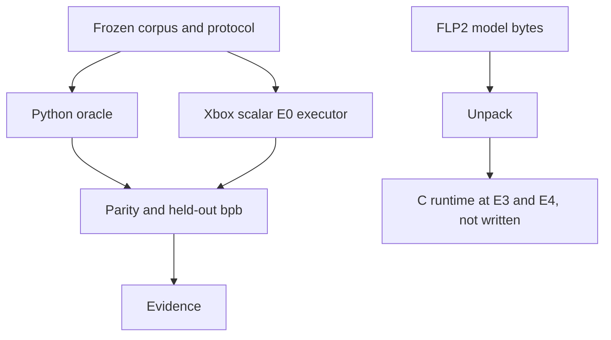

# Architecture

Owner of how the host is divided. The thesis is [concept](concept.md). The 1/16
protocol is [ADR 0023](adr/0023-e1-1-16-pilot.md). Module lines are the
[code map](operations/code-map.md). What is running is [STATUS](STATUS.md).

An October 2026 sketch of this page sat on the unmerged branch
`docs/excellence-research-20261001`. This page replaces that sketch. That
branch's excellence plan, paper outline, and research notes 08–12 stay
unmerged history.

## Stored model

One `TinyGPT`. Pre-norm RMSNorm, RoPE, causal attention, a tied embedding, and
an MLP. Each block stores two norms and four quantized matrices: query-key-value,
the attention projection, and the two MLP matrices. `GPTConfig` carries the
scalar fields only. A vector core does not add a field.

The code accepts `core_fmt` `ternary`, `2bit`, `4bit`, and `vq`. Scientific E0
cores are ternary and 2-bit. `vq` is not one of those scalar formats. Norms are
raw fp16. A `vq` core requires a 4-bit embedding, and E0 uses that embedding. A
scalar config may choose another embedding format.

A vector core sets `core_fmt` to `vq` and takes one `VectorBook`. Every core
matrix shares that book. Core scales stay `row8log`. `delta` stays in the header
and the vector core does not read it. The forward runs each block once. The
thesis is a recursive core; this host is the K=1 pilot from ADR 0023. Recursion
is E1a, and a computed trellis is E1b. Neither is in this host.

## File

[ADR 0006](adr/0006-flp2-only.md) makes FLP2 the only blob. A scalar artifact has
an empty shared section. A vector artifact stores one `VQB1` book in that
section, once, not once per matrix. `VQF1` remains the CPU qualification fixture
from [ADR 0013](adr/0013-e1-functional-qualification.md). The byte order is
decision 14 of [ADR 0023](adr/0023-e1-1-16-pilot.md).

A fixed book is 16 header bytes: the `VQB1` mark, dimension, bits, generator,
learned flag, and the seed. It stores no entries. A learned book appends its
fp16 entries after that header. Scales sit in each tensor record.

A core vector record pads the column axis up to a multiple of the group
dimension, then entropy-codes the group indices with `rans.encode_best`. Decode
drops the padded columns. The padding indices are in the coded stream.
`nominal_bits` is not the size parity reads. Parity reads the whole FLP2 file:
header, book, scales, coded indices, and fp16 norms.

[ADR 0004](adr/0004-miniature-budgets.md) compares those coded model bytes at
1/16 and 1/4. The runtime binary and the tokenizer enter the count at 1×.

## Training

Scalar WSD is unchanged. `TrainSpec` has no vector fields, so a scalar
checkpoint spec stays the same. The values are ADR 0023 decisions 7–9. The host
keeps them as constants in `train.py`.

Only core matrices assign, and they assign before the forward on the cadence.
The step holds their indices and scale bytes. Partial-quantization probability
0.1 means about one group in ten uses that quantized reconstruction on the
step; the other groups use the master weight. The embedding stays full 4-bit
fake-quantization on every step and does not assign.

Evaluation and the cooldown file use the held assignment for every group. That
file is the quantized FLP2 container. Master weights and optimizer moments are
training state. A checkpoint of the masters is not the scored result.

A learned book reseeds an unused entry from the same PCG32 stream. A fixed book
logs the dead entry and keeps the seed, because the file stores the seed and a
rewritten entry would not round-trip.

`scripts/e1_qualify.py` still calls `snap()` and rewrites master weights. That
is the ADR 0013 qualification canary. It is not the scientific step.

## Two machines

The Python campaign computes held-out bpb. The Python oracle is the numerical
reference, including the vector core. The Xbox package trains scalar E0. It is
not a vector executor. [ADR 0023](adr/0023-e1-1-16-pilot.md) keeps the 1/16
pilot on CPU until a vector executor matches this oracle on identical inputs
and identical artifact bytes.

The disk path is the mounted data floppy. The static C runtime, tokenizer
image, and FAT12 layout are E3 and E4. They are not in this repository.

## Responsibility map

| Layer | Source | Boundary |
| --- | --- | --- |
| Model | `src/floppylm/model.py`, `codec.py` | Scalar and vector TinyGPT. The book is an argument, not a config field. |
| Book and vector oracle | `src/floppylm/vq.py` | One VQB1 book, PCG32, assignment. VQF1 stays a fixture. |
| Training | `src/floppylm/train.py` | WSD trunk and cooldowns. Vector cadence is not a TrainSpec field. Core matrices assign; the embedding does not. |
| Serialization | `src/floppylm/pack.py`, `rans.py` | FLP2. One VQB1 when `core_fmt` is `vq`. Indices are entropy-coded. FLP1 is rejected. |
| Qualification canary | `scripts/e1_qualify.py` | ADR 0013. `snap()` rewrites masters. Not the scientific step. |
| Experiment control | `experiments/`, `parity.py`, `runlog.py`, `e1_plan.py`, `e1_pilot.py` | E0 campaigns, eligibility, paired differences. `e1_plan.py` materializes the specified scalar arms, the four G=8 books, and the ADR 0024 seed-0 solver. It does not train. `e1_pilot.py` is the CPU campaign path. Its synthetic smoke is functional and is not a result. Fixed rate 0.5 is closed at `d` 80, 12 layers, `d_ff` 247, 85934 bytes. Learned rate 0.5 is closed at `d` 256, 1 layer, `d_ff` 801, 85935 bytes. Fixed rate 0.75 is closed at `d` 80, 8 layers, `d_ff` 258, 85938 bytes. Learned rate 0.75 is closed at `d` 160, 2 layers, `d_ff` 479, 85939 bytes. T is 20780800. The pilot cells have not started. |
| Xbox client | `src/floppylm_xbox/` | Portal and jobs. The core package does not import it. |
| Native scalar executor | `xbox-gpu-training` | DX12/UWP E0 trainer. It consumes contracts defined here ([ADR 0012](adr/0012-repo-boundaries.md)). |
| Final image | roadmap E3/E4 | Static C runtime on a FAT12 data floppy. Not written. |

## Checks

`pack(unpack(blob))` must return the same bytes. PCG32 matches the independent
C snippet in `tests/test_vq.py`. [ADR 0010](adr/0010-independent-numerical-gates.md)
is the numerical gate for Xbox scalar kernels against this oracle. It does not
qualify a vector executor. A host test is not GPU acceptance and is not a disk
demonstration. Whether a campaign or a pilot is running is recorded only in
[STATUS](STATUS.md).
